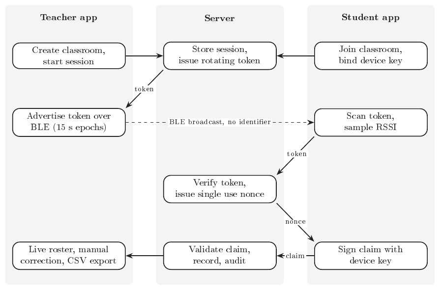
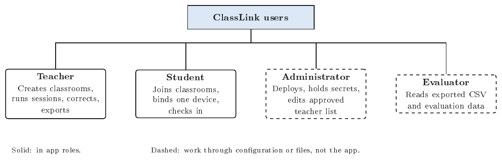
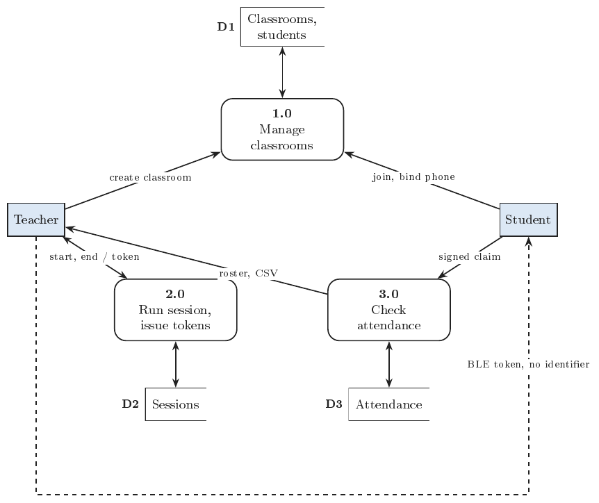
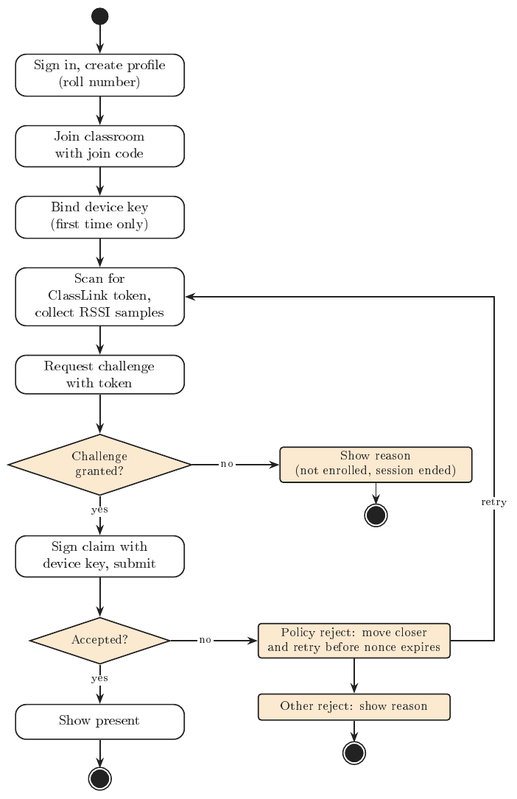
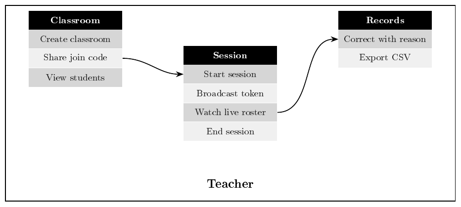
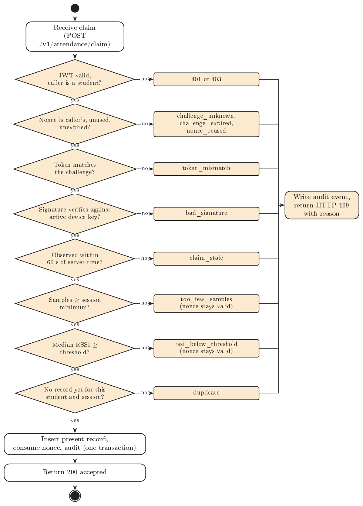

# Software Requirements Specification

**ClassLink: A BLE Based Classroom Attendance System**

Version 1.0, October 2026. UCS503P Software Engineering Project, Thapar Institute of Engineering and Technology.

Prepared by Vemula Manvi Smaran (1024160111), Vrishank Nehru (1024160109), Mahi Singh (1024160102), and Khagendra Saini (1024160123). Submitted to Anshuka.

The glossary, API summary, rejection codes, evaluation plan, test traceability, and two more diagrams live in the [supplement](supplement.md).

# 1. Introduction

## 1.1 Purpose

This document says what ClassLink must do, who uses it, and how we will judge that it works. ClassLink replaces roll call with a Bluetooth Low Energy (BLE) check and a server that decides who counts as present. The document guides development, testing, and project review.

## 1.2 Intended Audience and Reading Suggestions

The readers are the project team, the course instructor, testers, and pilot teachers. Section 1 introduces the project. Section 2 describes the system, its users, and its design with diagrams. Section 3 lists the features and requirements with their status. Section 4 sets quality rules, and Section 5 covers deployment and privacy.

## 1.3 Project Scope

Manual attendance is slow, easy to fake, and hard to audit. In ClassLink the teacher's phone broadcasts a short lived token over Bluetooth. Each student's phone picks it up, measures the signal strength, and sends a signed claim to a server. The server decides whether the claim counts and keeps the record.

**Status terms.** *Done* means built and covered by an automated test. *POC* means present only in the offline proof of concept. *Planned* means specified but not built. Today the server side is built and tested. The Android app does not call it yet, so anything that needs the app is Planned.

{width=100%}

**In scope.** Teacher and student roles on Android. Classrooms with join codes. One registered phone per student. Attendance sessions with a signal strength rule. A live roster, manual corrections, and CSV export. An audit log. Testing on real phones in a real room.

**Out of scope.** Proving that the phone's owner is the person holding it. Student to student relaying. iOS support. Links to learning management systems, grading, or timetables.

# 2. Overall Description

## 2.1 Product Perspective

ClassLink grew from an offline proof of concept, the Flutter app in `code/`, that showed a teacher phone can announce a session over BLE and a student phone can check in by proximity. Version 1.0 adds a server so the result no longer depends on trusting the student's phone.

The system has three parts. The **mobile app** (Flutter, Android first) runs in a teacher mode and a student mode. The **backend API** (FastAPI, Python) checks users, owns sessions and tokens, and decides every claim. The **database** (Supabase Postgres) stores classrooms, sessions, and attendance, and Supabase Auth signs users in.

One check in works like this. The teacher app fetches a fresh token from the server every 15 seconds and broadcasts it. A student phone hears the token and asks the server for a one time challenge. The phone measures signal strength for a few seconds, signs the result with its own key, and sends it. The server verifies the claim and records attendance.

## 2.2 User Classes and Characteristics

- **Teacher.** Runs sessions for classrooms they own. The role comes only from an email allowlist kept by the administrator.
- **Student.** Joins classrooms with a join code and checks in with one registered phone.
- **Administrator.** Deploys the server and edits the teacher allowlist. This is not an in app role.
- **Evaluator.** Reads the exported CSV files. No app access needed.

{width=100%}

## 2.3 Product Functions

1. **Accounts and classrooms.** Sign in, get a role, create or join a classroom.
2. **Device binding.** Register the key that signs a student's claims.
3. **Sessions and tokens.** Start and end a session and issue rotating tokens.
4. **Attendance claims.** Challenge, sign, check, and record.
5. **Roster, corrections, export.** Watch check ins, fix mistakes with a reason, download a CSV.
6. **Audit.** Record every security relevant action.

{width=100%}

## 2.4 Operating Environment

Students and teachers use Android 8.0 or later with Bluetooth LE. The teacher phone must support BLE advertising, so we test on real phones. The server runs in a Linux container behind HTTPS. The database is Supabase Postgres. Phones need internet during check in, but the Bluetooth exchange itself does not.

We assume students use the phone they registered, a student who changes phones registers again, and phone and server clocks stay within about a minute.

## 2.5 Design

These rules shape the design.

- **Android first.** We make no claim about untested platforms.
- **Small, anonymous token.** The BLE token is 17 bytes and carries no student or teacher identity. It travels as manufacturer data, because a service identifier plus the token does not fit in a basic advertisement. We have not yet confirmed this layout on phones.
- **Teacher broadcasts, student listens.** There is no relay between students.
- **The server decides.** A phone never creates an attendance record on its own.
- **Secrets stay on the server.** Only `.env.example` files enter the repository.
- **Signal strength is noisy.** The server uses the median of several samples against a per session threshold.
- **Apps write only through the API.** The database gives apps read only access to their own rows.
- **Real data only.** Evaluation figures come only from recorded real runs.

The student signs in, joins a classroom, registers the phone once, and then checks in each session.

{height=14cm}

The teacher creates a classroom, starts a session, watches the roster, and corrects mistakes with a reason.

{height=13cm}

The server checks each claim in order. The first failed check ends the flow with a reason, and every outcome is audited.

{height=16cm}

# 3. System Features

## 3.1 Description and Priority

| Feature | Description | Priority | Status |
|---|---|---|---|
| Attendance claims | Challenge, signed claim, server checks | High | Server done, app planned |
| Sessions and tokens | Start and end sessions, rotating BLE token | High | Server done, app planned |
| Device binding | One registered key per student | High | Server done, app planned |
| Accounts and classrooms | Sign in, roles, join codes | High | Server done, app planned |
| Roster and corrections | Live list, fixes with a reason | High | Server done, app planned |
| Export and audit | CSV download, audit log | Medium | Server done |
| Offline mode | Original no server demo | Low | POC |

## 3.2 Functional Requirements

Priority: **M** must, **S** should, **C** could.

**Accounts and classrooms**

| ID | Requirement | Pri | Status |
|---|---|---|---|
| FR-ACC-01 | The API shall accept only requests with a valid, unexpired Supabase token and answer all others with HTTP 401. | M | Done |
| FR-ACC-02 | A user shall have one profile with the role teacher or student. Only emails on the server allowlist become teachers. A student profile shall require a roll number. | M | Done |
| FR-ACC-03 | Students shall not reach teacher operations, and teachers shall not reach student operations (HTTP 403). | M | Done |
| FR-CLS-01 | A teacher shall create a classroom and receive a unique six character join code. | M | Done |
| FR-CLS-02 | A student shall join a classroom with its code. An unknown code shall return HTTP 404. | M | Done |

**Device binding**

| ID | Requirement | Pri | Status |
|---|---|---|---|
| FR-DEV-01 | A student shall register one device key (ECDSA P-256 public key). The server shall reject any other key type. | M | Done |
| FR-DEV-02 | Registering a new key shall revoke the old one and write an audit event. | M | Done |
| FR-DEV-03 | The private key shall never leave the phone, and the app shall sign only after fingerprint or screen lock authentication. | M | Planned |

**Sessions and tokens**

| ID | Requirement | Pri | Status |
|---|---|---|---|
| FR-SES-01 | A teacher shall start a session for their own classroom with a signal threshold (default −75 dBm), a sample window (default 4 s), and a minimum sample count (default 3). A classroom shall have at most one active session. | M | Done |
| FR-SES-02 | A teacher shall end a session. After that the server shall reject its tokens, challenges, and claims. | M | Done |
| FR-SES-03 | The server shall issue a 17 byte rotating token that changes every 15 seconds and carries no student or teacher identity. | M | Done |
| FR-SES-04 | Only the classroom's teacher shall see or change its sessions. Other teachers shall get HTTP 404. | M | Done |
| FR-SES-05 | The teacher app shall fetch a fresh token each period and broadcast it. | M | Planned |

**Attendance claims**

| ID | Requirement | Pri | Status |
|---|---|---|---|
| FR-ATT-01 | The student app shall scan for the token and collect signal strength samples. | M | Planned |
| FR-ATT-02 | On a challenge request the server shall check the token, the active session, enrollment, and the student's registered device, then issue a single use nonce valid for 120 seconds. | M | Done |
| FR-ATT-03 | A claim shall hold the nonce, token, median signal strength, sample count, and observation time (whole Unix seconds), signed with the device key over a fixed text format. | M | Done |
| FR-ATT-04 | The server shall accept a claim only if the nonce is the caller's, unused, and unexpired, the token matches, the signature verifies, the observation time is within 60 seconds of server time, the sample count meets the minimum, and the median signal meets the threshold. | M | Done |
| FR-ATT-05 | A student shall have at most one attendance record per session. Repeating an accepted claim shall return the same record. | M | Done |
| FR-ATT-06 | A weak signal or too few samples shall leave the nonce usable so the student can move closer and retry. | S | Done |
| FR-ATT-07 | Every rejection shall carry a reason code (listed in the supplement) with HTTP 409. | M | Done |
| FR-ATT-08 | The student app shall show the result and explain each reason in plain words. | M | Planned |

**Roster, corrections, export, audit**

| ID | Requirement | Pri | Status |
|---|---|---|---|
| FR-ROS-01 | A teacher shall see every enrolled student of a session with status, source, signal strength, and time. | M | Done |
| FR-ROS-02 | The teacher app shall refresh the roster at least every 5 seconds during a session. | S | Planned |
| FR-COR-01 | A teacher shall mark a student present or absent with a reason of at least five characters. The server shall audit each correction. | M | Done |
| FR-EXP-01 | A teacher shall download a session as CSV with every enrolled student. The export shall neutralise cells that start with `=`, `+`, `-`, or `@`. | M | Done |
| FR-AUD-01 | The server shall audit classroom creation, device binding, session start and end, accepted and rejected claims, corrections, and exports. Apps shall have no access to the audit log. | M | Done |
| FR-POC-01 | The original offline mode shall remain and be labelled as not authoritative. | C | POC |

## 3.3 Implementation Requirements

The server is a FastAPI service on Python 3.11 or later, with psycopg 3 against Supabase Postgres and Supabase Auth. The app is Flutter, Android first, using `bluetooth_low_energy`. The server is built and tested against a real Postgres. The app still needs its API client, sign in, key storage, token broadcast, and roster screens. Section 3.2 marks each of these.

# 4. Other Nonfunctional Requirements

## 4.1 Performance Requirements

These are targets. We report only values measured in the pilot.

- Discovery: a student phone shall pick up the token within 5 seconds in the same room.
- Check in: from scan start to server result within 10 seconds.
- API: p95 under 500 ms for challenge and claim calls with 50 students at once.
- Capacity: one classroom of 300 students with up to 150 check ins at once.

## 4.2 Security Requirements

- All traffic shall use HTTPS in production.
- Secrets, such as the token key and database credentials, shall exist only on the server. CI shall fail if a `.env` file or keystore is committed.
- The database shall have row level security on every table. Apps read only their own rows and write nothing.
- A signed claim shall cover the session, nonce, token, signal strength, sample count, and time, so changing any value breaks the signature.
- The server shall check token tags in constant time and verify every request's token signature, expiry, and audience.
- The system shall store only name, roll number, email, a device public key, and attendance. It shall not collect location.

ClassLink resists casual proxy attendance. It does not stop a friend who holds the student's unlocked phone, or someone who relays a live token to a faraway phone within its few seconds of life. Short token periods, the signal rule, and the audit log reduce these risks but do not remove them.

## 4.3 Software Quality Attributes

- **Reliability:** attendance writes are atomic and safe to retry. Two racing claims for one student produce one record.
- **Availability:** `/healthz` and `/readyz` report server and database health.
- **Maintainability:** the backend passes Ruff and strict MyPy in CI, and every Done requirement has an automated test.
- **Portability:** the server runs from one container image configured by environment variables.
- **Usability:** a student checks in with one tap, and every rejection has a plain explanation.

## 4.4 Business Rules

- A student has at most one attendance record per session.
- Only a classroom's teacher can see or change its attendance.
- A manual correction always has a reason and a named teacher.
- An ended session never restarts. A new session gets new tokens.
- A student has one active phone. Replacing it revokes the old key.
- Only the administrator decides who becomes a teacher.

# 5. Other Requirements

**Deployment.** The server builds into a container with a non root user and refuses to start in production without its database URL and secrets. The administrator applies the migration file to Supabase before the first start. GitHub Actions runs the app and server checks and rejects committed secrets. The team publishes a signed Android APK for the pilot. See `docs/deployment.md`.

**Privacy.** Pilot participants learn what the app stores before they join a classroom. Deleting a user deletes their profile, enrollments, devices, and attendance.

**Documentation.** The repository holds this SRS in Markdown and LaTeX, the project proposal, UML diagrams, the deployment runbook, and the API reference served at `/docs`.
