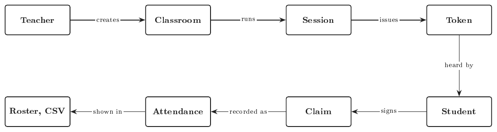
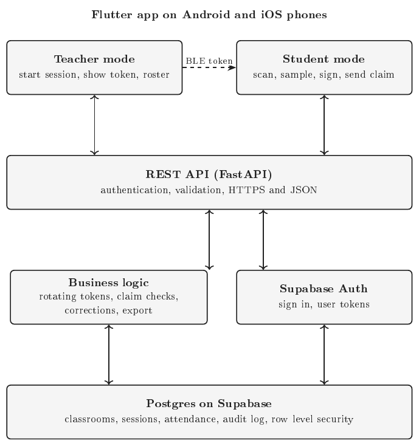
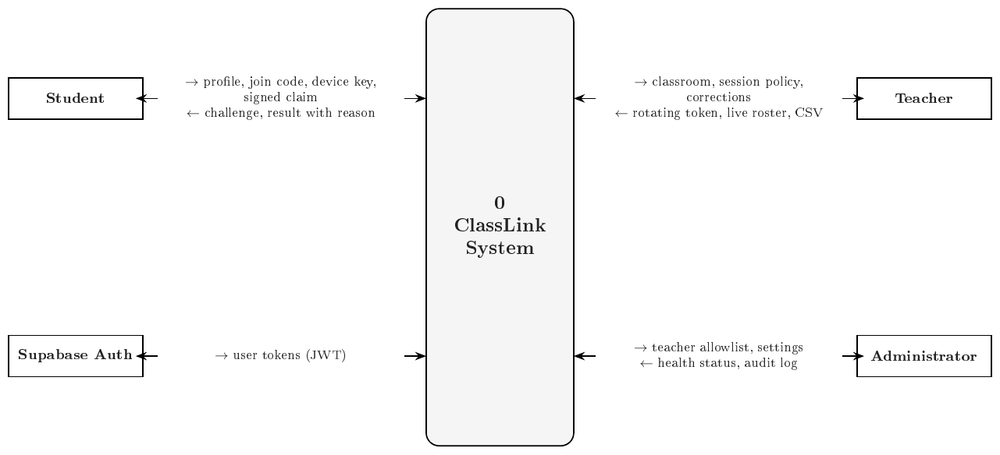
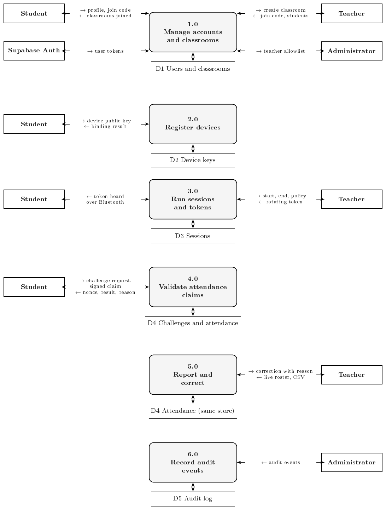
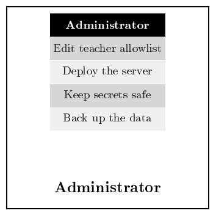
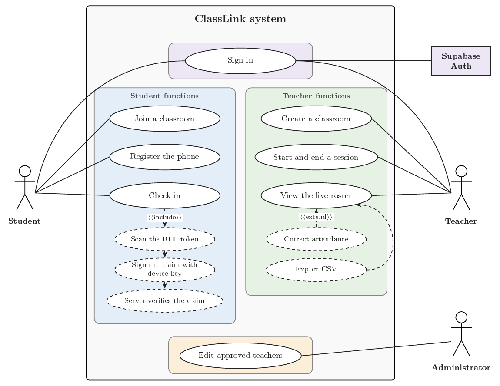

# Software Requirements Specification

**ClassLink: A BLE Based Classroom Attendance System**

Version 1.0, October 2026. UCS503P Software Engineering Project, Thapar Institute of Engineering and Technology.

Prepared by Vemula Manvi Smaran (1024160111), Vrishank Nehru (1024160109), Mahi Singh (1024160102), and Khagendra Saini (1024160123). Submitted to Anushka Ma'am.

The glossary, API summary, rejection codes, evaluation plan, test traceability, and two more diagrams live in the [supplement](supplement.md).

# 1. Introduction

## 1.1 Purpose

Taking attendance by roll call eats lecture time, and a signed sheet or a shouted "present" is easy to fake and hard to check later. ClassLink is the fix. It is a classroom attendance system where the teacher's phone broadcasts a short lived Bluetooth Low Energy (BLE) token, each student's phone hears it and sends a signed claim, and a server decides who counts as present. The main idea is that the phone never decides for itself, so the record can be trusted.

This document is the Software Requirements Specification (SRS) of ClassLink Version 1.0. It follows the approved project proposal (UCS503P). Requirements carry an ID such as FR (functional) and a priority from the MoSCoW scheme: Must (needed for the pilot), Should (next iteration), Could (optional). A Status column says what is built today.

## 1.2 Intended Audience and Reading Suggestions

This SRS is for developers, testers, pilot teachers, and the course instructor. It gives the internal, external, functional, and nonfunctional details of ClassLink. Every requirement is written so a test can check it.

Key terms used in this document:

- **BLE (Bluetooth Low Energy)**: the short range radio the phones use. It needs no pairing.
- **Token**: a 17 byte code the teacher phone broadcasts. It changes every 15 seconds and names no person.
- **Challenge (nonce)**: a one time code the server gives a student before a check in, so nobody can reuse an old claim.
- **Claim**: the signed message a student phone sends. It holds the one time code, token, signal strength, sample count, and time.
- **RSSI**: received signal strength in dBm. A larger number (closer to zero) means a closer phone.
- **Session**: one class period in which attendance is open.
- **Device key**: the signing key kept on a student's phone. The server stores only its public half.
- **Audit log**: the server's permanent record of who did what.
- **POC**: the earlier offline proof of concept app.

## 1.3 Project Scope

ClassLink gives Teachers and Students one place to run attendance, and gives the Administrator control over who may teach. It records presence only. It does not grade, schedule, or track location.

**Objectives.**

1. Speed: a student checks in within 10 seconds of starting the scan, so roll call stops costing lecture time.
2. Trust: the server verifies every claim, so a phone cannot mark itself present.
3. Traceability: every claim, rejection, and correction leaves a record.
4. Teacher control: a live roster, manual corrections with a reason, and CSV export.
5. Privacy: the system keeps only name, roll number, email, a device public key, and attendance. It never collects location.
6. Engineering quality: the backend passes Ruff and strict MyPy, and every requirement marked Done has an automated test run in CI.

**In scope.** Teacher and student roles on Android and iOS, built from one Flutter code base. Classrooms with join codes. One registered phone per student. Attendance sessions with a signal strength rule. A live roster, manual corrections, and CSV export. An audit log. Testing on real phones in a real room.

**Optional extensions** (outside this course submission). Links to learning management systems, and a signal threshold that adapts to each room.

**Out of scope.** Proving that the phone's owner is the person holding it. Student to student relaying. Grading and timetables.

**Status terms.** *Done* means built and covered by an automated test. *POC* means present only in the offline proof of concept. *Planned* means specified but not built. Today the server side is built and tested. The mobile apps (Android and iOS) do not call it yet, so anything that needs an app is Planned.

**Stakeholders.**

| Stakeholder | Role | Main interest |
|---|---|---|
| Students | Join classrooms, register a phone, check in | A quick check in that counts |
| Teachers | Create classrooms, run sessions, correct records | Accurate attendance without roll call |
| Administrator | Sets up the server, edits the approved teacher list | A secure, running system |
| Development team | Design, build, test, deploy | Clear, testable requirements |
| Course instructor | Reviews and evaluates the project | Consistency with the approved proposal |
| Supabase | Hosts the database and sign in | Fair use of its free tier |

Table: Stakeholders of ClassLink.

{width=100%}

Figure 1.1 is the overview of the project. A Teacher creates a Classroom. The Classroom runs a Session. The Session issues rotating Tokens. A Student hears a Token and signs a Claim. The server checks the Claim into an Attendance record, and the Teacher sees it in the Roster and CSV. Every entity feeds the next one, so the whole system works as one chain.

# 2. Overall Description

## 2.1 Product Perspective

ClassLink grew from an offline proof of concept, the Flutter app in `code/`, that showed a teacher phone can announce a session over BLE and a student phone can check in by proximity. Version 1.0 adds a server so the result no longer depends on trusting the student's phone. It follows a layered client and server design (Figure 2.1).

- **Mobile app:** Flutter, for Android and iOS, with a teacher mode and a student mode.
- **Backend API:** FastAPI (Python) for sign in checks, validation, sessions, and claims.
- **Business logic:** rotating tokens, claim checks, corrections, and export.
- **Database:** Supabase Postgres. Supabase Auth signs users in.

{width=80%}

One check in works like this. The teacher app fetches a fresh token from the server every 15 seconds and broadcasts it. A student phone hears the token and asks the server for a one time challenge. The phone measures signal strength for a few seconds, signs the result with its own key, and sends it. The server verifies the claim and records attendance.

## 2.2 User Classes and Characteristics

ClassLink has four user classes (Figure 2.2).

- **Teacher.** Runs sessions for classrooms they own. The role comes only from a list of approved teacher emails kept by the administrator.
- **Student.** Joins classrooms with a join code and checks in with one registered phone.
- **Administrator.** Sets up the server and edits the approved teacher list. This is not an in app role.
- **Evaluator.** Reads the exported CSV files. No app access needed.

Supabase Auth is the one external system. It signs users in and issues their tokens.

Students and teachers need only basic phone skills. The administrator needs medium technical skill.

{width=100%}

## 2.3 Product Functions

ClassLink stores classrooms, sessions, and attendance, and keeps a record of every important action. At a high level it lets users sign in and get a role, create or join a classroom, register a device key, start and end sessions with rotating tokens, check in with a signed claim, watch a live roster, correct mistakes with a reason, and export a CSV. Users must sign in before using any of these functions.

The main data records are:

- **profiles**: user id, role (teacher or student), full name, roll number, email.
- **classrooms**: classroom id, teacher id, name, unique join code.
- **enrollments**: classroom id and student id, with the join time.
- **devices**: student id, public key, label, time it was cancelled. A student has one active device.
- **sessions**: classroom id, alias, signal threshold, sample window, minimum samples, start and end time. A classroom has at most one active session.
- **challenges**: session id, student id, token, issue and expiry time, used time. Each is single use.
- **attendance**: session id, student id, status, source (BLE claim or manual correction), median RSSI, sample count, time of measurement, and correction details. One record per student per session.
- **audit_events**: actor, action, subject, details, time.

Links between the tables keep the data consistent. The level 0 diagram (Figure 2.3) treats ClassLink as one box and shows what crosses its edge. Arrows pointing right mean data going in. Arrows pointing left mean data coming out.

{width=100%}

Level 1 (Figure 2.4) opens the box into six processes. Each process keeps its data in a store, drawn under it.

{height=20cm}

## 2.4 Operating Environment

Students and teachers use an Android phone (8.0 or later) or an iPhone, both with Bluetooth LE. The lowest iOS version is still to be confirmed. The teacher phone must support BLE advertising, so we test on real phones of both kinds. The server runs in a Linux container behind HTTPS. The database is Supabase Postgres. Phones need internet during check in, but the Bluetooth exchange itself does not.

**External interfaces.**

- **User interface:** a Flutter app with a teacher mode (classrooms, session control, live roster, corrections, export) and a student mode (join, register phone, check in, result). Every rejection shows a plain explanation.
- **Hardware:** Bluetooth LE radio. The teacher phone needs BLE advertising. No other hardware.
- **Software:** FastAPI backend, Supabase Postgres, Supabase Auth, GitHub Actions for CI.
- **Communications:** HTTPS with JSON over REST. A Supabase sign in token (JWT) in the Authorization header. A 17 byte token inside the BLE advertisement.

**Design and implementation constraints.**

- Stack: Flutter (Android and iOS), FastAPI on Python 3.11 or later, psycopg 3, Supabase Postgres and Auth.
- A phone never creates an attendance record on its own. Only the server decides.
- Secrets stay on the server. Only `.env.example` files enter the repository.
- The BLE token is 17 bytes and travels in the manufacturer data field of the BLE advertisement, because a service identifier plus the token does not fit in a basic one. We have not yet confirmed this layout on phones. iOS only lets an app advertise a local name and service identifiers, so an iPhone may not be able to broadcast the token this way. We test this first, and the token layout or the teacher device may need to change.
- Apps write only through the API. The database gives apps read only access to their own rows.
- Four person team, one semester, with the work split across backend, app, documentation, and testing.

**Assumptions and dependencies.**

- Students use the phone they registered. A student who changes phones registers again.
- Phone and server clocks stay within about a minute.
- Supabase free tier limits are enough for the pilot.
- Signal strength is noisy, so the server uses the median of several samples against a per session threshold. The right threshold is tuned on real phones.

## 2.5 Design

A check in follows the flow in Figure 2.5. It crosses three places: the teacher app, the server, and the student app.

{width=100%}

Student activities have three steps: join a classroom, register the phone once, and check in. Everything ends in the student's profile (Figure 2.6).

{width=100%}

Teacher activities (Figure 2.7) cover setting up a classroom, running a session, and keeping the records straight.

{width=100%}

The administrator has one small job. They keep the server running and decide who is a teacher (Figure 2.8).

{width=45%}

Figure 2.9 shows every use case and who starts it.

{height=16cm}

**UC-1 Check in to a session.** Actor: student, who must be signed in, enrolled, and have a registered phone. The teacher has a session running. The student taps Check in. The app scans for the token for the sample window and requests a challenge. The server checks the token, session, enrollment, and device, then issues a one time code. The app signs the claim and sends it. The server checks the one time code, signature, time, sample count, and median signal, then records attendance and shows Present. If the signal is weak or samples are too few, the student sees a plain message and may move closer and retry. Any other failure shows its reason code and nothing is recorded.

**UC-2 Correct attendance.** Actor: teacher, who owns the classroom. The teacher opens the roster, picks a student, and marks them present or absent with a reason of at least five characters. The server stores the change with the teacher's name and writes an audit event. A reason that is too short is refused and nothing changes.

The design rules behind these flows:

- **Teacher broadcasts, student listens.** There is no relay between students.
- **The server decides.** Every claim is checked on the server.
- **Real data only.** Evaluation figures come only from recorded real runs.

# 3. System Features

ClassLink is a classroom attendance system. The main part of this product is to accept a signed BLE claim and decide on the server whether it counts.

## 3.1 Description and Priority

ClassLink has main features and some sub features. In priority order, from top to bottom:

1. **Attendance claims** (Must, pilot): challenge, signed claim, server checks. This is the goal feature of the software.
2. **Sessions and tokens** (Must, pilot): start and end sessions, rotating BLE token.
3. **Device binding** (Must, pilot): one registered key per student.
4. **Accounts and classrooms** (Must, pilot): sign in, roles, join codes.
5. **Roster and corrections** (Must, pilot): live list, fixes with a reason.
6. **Export and audit** (Should): CSV download and audit log.
7. **Offline mode** (Could): the original no server demo, labelled as not the official record.

The first meaningful milestone is a working pilot where a teacher starts a session, a student checks in from a real phone, and the roster shows the result. The server side of this is done. The app side is planned.

## 3.2 Functional Requirements

The server is a FastAPI service built and tested against a real Postgres. The app still needs its API client, sign in, key storage, token broadcast, and roster screens. Priority is Must, Should, or Could. The Status column marks what is built.

**Accounts and classrooms**

| ID | Requirement | Priority | Status |
|---|---|---|---|
| FR-ACC-01 | The API shall accept only requests with a valid, unexpired Supabase token and answer all others with HTTP 401. | Must | Done |
| FR-ACC-02 | A user shall have one profile with the role teacher or student. Only emails on the approved teacher list become teachers. A student profile shall require a roll number. | Must | Done |
| FR-ACC-03 | Students shall not reach teacher operations, and teachers shall not reach student operations (HTTP 403). | Must | Done |
| FR-CLS-01 | A teacher shall create a classroom and receive a unique six character join code. | Must | Done |
| FR-CLS-02 | A student shall join a classroom with its code. An unknown code shall return HTTP 404. | Must | Done |

**Device binding**

| ID | Requirement | Priority | Status |
|---|---|---|---|
| FR-DEV-01 | A student shall register one device key (ECDSA P-256 public key). The server shall reject any other key type. | Must | Done |
| FR-DEV-02 | Registering a new key shall cancel the old one and write an audit event. | Must | Done |
| FR-DEV-03 | The private key shall never leave the phone (kept in the Android Keystore or the iOS Keychain), and the app shall sign only after fingerprint, face, or screen lock authentication. | Must | Planned |

**Sessions and tokens**

| ID | Requirement | Priority | Status |
|---|---|---|---|
| FR-SES-01 | A teacher shall start a session for their own classroom with a signal threshold (default −75 dBm), a sample window (default 4 s), and a minimum sample count (default 3). A classroom shall have at most one active session. | Must | Done |
| FR-SES-02 | A teacher shall end a session. After that the server shall reject its tokens, challenges, and claims. | Must | Done |
| FR-SES-03 | The server shall issue a 17 byte rotating token that changes every 15 seconds and carries no student or teacher identity. | Must | Done |
| FR-SES-04 | Only the classroom's teacher shall see or change its sessions. Other teachers shall get HTTP 404. | Must | Done |
| FR-SES-05 | The teacher app shall fetch a fresh token each period and broadcast it. | Must | Planned |
| FR-SES-06 | On iOS the teacher app shall broadcast the token in a layout iOS allows. If that is not possible, the document shall say that an Android phone must act as the teacher device. | Should | Planned |

**Attendance claims**

| ID | Requirement | Priority | Status |
|---|---|---|---|
| FR-ATT-01 | The student app shall scan for the token and collect signal strength samples. | Must | Planned |
| FR-ATT-02 | On a challenge request the server shall check the token, the active session, enrollment, and the student's registered device, then issue a one time code (nonce) valid for 120 seconds. | Must | Done |
| FR-ATT-03 | A claim shall hold the one time code, token, median signal strength, sample count, and time of measurement (whole seconds), signed with the device key over a fixed text format. | Must | Done |
| FR-ATT-04 | The server shall accept a claim only if the one time code is the caller's, unused, and unexpired, the token matches, the signature verifies, the time of measurement is within 60 seconds of server time, the sample count meets the minimum, and the median signal meets the threshold. | Must | Done |
| FR-ATT-05 | A student shall have at most one attendance record per session. Repeating an accepted claim shall return the same record. | Must | Done |
| FR-ATT-06 | A weak signal or too few samples shall leave the one time code usable so the student can move closer and retry. | Should | Done |
| FR-ATT-07 | Every rejection shall carry a reason code (listed in the supplement) with HTTP 409. | Must | Done |
| FR-ATT-08 | The student app shall show the result and explain each reason in plain words. | Must | Planned |

**Roster, corrections, export, audit**

| ID | Requirement | Priority | Status |
|---|---|---|---|
| FR-ROS-01 | A teacher shall see every enrolled student of a session with status, source, signal strength, and time. | Must | Done |
| FR-ROS-02 | The teacher app shall refresh the roster at least every 5 seconds during a session. | Should | Planned |
| FR-COR-01 | A teacher shall mark a student present or absent with a reason of at least five characters. The server shall audit each correction. | Must | Done |
| FR-EXP-01 | A teacher shall download a session as CSV with every enrolled student. The export shall make safe any cell that starts with `=`, `+`, `-`, or `@`. | Must | Done |
| FR-AUD-01 | The server shall audit classroom creation, device binding, session start and end, accepted and rejected claims, corrections, and exports. Apps shall have no access to the audit log. | Must | Done |
| FR-POC-01 | The original offline mode shall remain and be labelled as not the official record. | Could | POC |

# 4. Other Nonfunctional Requirements

## 4.1 Performance Requirements

These are targets. We report only values measured in the pilot.

- Discovery: a student phone shall pick up the token within 5 seconds in the same room.
- Check in: from scan start to server result within 10 seconds.
- API: p95 under 500 ms for challenge and claim calls with 50 students at once.
- Capacity: one classroom of 300 students with up to 150 check ins at once.

## 4.2 Security Requirements

- All traffic shall use HTTPS in production.
- Secrets, such as the token key and database credentials, shall exist only on the server. CI shall fail if a `.env` file or keystore is committed.
- The database shall have row level security on every table, so each user sees only their own rows. Apps read but never write.
- A signed claim shall cover the session, one time code, token, signal strength, sample count, and time, so changing any value breaks the signature.
- The server shall compare token tags with a timing safe method, and check every request's sign in token for its signature, expiry, and intended use.
- The system shall store only name, roll number, email, a device public key, and attendance. It shall not collect location.

ClassLink stops casual proxy attendance (a friend marking you present). It does not stop a friend who holds the student's unlocked phone, or someone who relays a live token to a faraway phone within its few seconds of life. Short token periods, the signal rule, and the audit log reduce these risks but do not remove them.

## 4.3 Software Quality Attributes

- **Reliability:** attendance writes happen fully or not at all, so a retry is safe. If two claims for one student arrive together, only one record is made.
- **Availability:** the pages `/healthz` and `/readyz` report whether the server and database are working.
- **Maintainability:** the backend passes Ruff and strict MyPy in CI, and every Done requirement has an automated test.
- **Portability:** the server runs from one ready to run package (a container image) and is set up with environment variables.
- **Usability:** a student checks in with one tap, and every rejection has a plain explanation.

**Acceptance criteria.**

| Metric | Target |
|---|---|
| Discovery | A phone picks up the token within 5 seconds in the same room |
| Check in time | Scan start to server result within 10 seconds |
| API speed | p95 under 500 ms for challenge and claim calls with 50 students at once |
| Functional completeness | All Must requirements demonstrated end to end on real phones |
| Test coverage | Every requirement marked Done has an automated test that passes in CI |
| Secret safety | CI fails if a `.env` file or keystore is committed |
| Honest results | Pilot figures come only from recorded real runs |

Table: Acceptance criteria.

## 4.4 Business Rules

- A student has at most one attendance record per session.
- Only a classroom's teacher can see or change its attendance.
- A manual correction always has a reason and a named teacher.
- An ended session never restarts. A new session gets new tokens.
- A student has one active phone. Replacing it cancels the old key.
- Only the administrator decides who becomes a teacher.

# 5. Other Requirements

ClassLink needs maintenance after the course, because phones, Android and iOS versions, and BLE behaviour keep changing. Other requirements are:

- **Documentation:** the repository holds this SRS in Markdown and LaTeX, the project proposal, UML diagrams, the deployment runbook, and the API reference served at `/docs`.
- **Deployment:** the server is packaged as a container that does not run as an admin user, and it refuses to start in production without its database address and secrets. The administrator runs the database setup file on Supabase before the first start. GitHub Actions runs the app and server checks and rejects committed secrets. The team publishes a signed Android APK and an iOS build for the pilot. How the iOS build reaches testers is still to be decided. See `docs/deployment.md`.
- **Privacy:** pilot participants learn what the app stores before they join a classroom. Deleting a user deletes their profile, enrollments, devices, and attendance. English only in the first version.
- **Phasing:** Phase 1 (done): server, database schema, tests, CI, and documents. Phase 2 (planned): Android and iOS apps with sign in, key storage, token broadcast, scan and claim, and roster screens. Phase 3 (planned): pilot on real phones in a real room, with measured results. Extensions follow only after the pilot.
- **Open issues to confirm:** whether the 17 byte token fits the BLE advertisement on real Android and iOS phones, and whether an iPhone can act as the teacher device; the signal threshold that works in a real room; whether to move the sign in token from a shared secret to public key signing; the Android application id, which still carries the old proof of concept name; and the consent wording for pilot students.

**Risks and mitigations.**

| Risk | What we do |
|---|---|
| Some phones cannot advertise BLE, and iOS limits what an advert can hold | Test on real Android and iOS phones early, list supported models, and fall back to an Android teacher phone if needed |
| Signal strength varies by room and phone | Median of several samples, a per session threshold, and a manual correction path |
| A friend relays a live token | Short token life, one time code, the signal rule, and the audit log |
| Server or database downtime | Health endpoints, a single container image, and managed Postgres |
| Leaked secrets | Secrets only on the server, and a CI check that rejects committed ones |
| Scope creep | Keep extensions out of the pilot, and track status in Section 3.2 |

**References.** (1) ClassLink Project Proposal, UCS503P, Thapar Institute of Engineering and Technology. (2) IEEE Std 830-1998, Recommended Practice for Software Requirements Specifications. (3) Supabase and FastAPI documentation.
