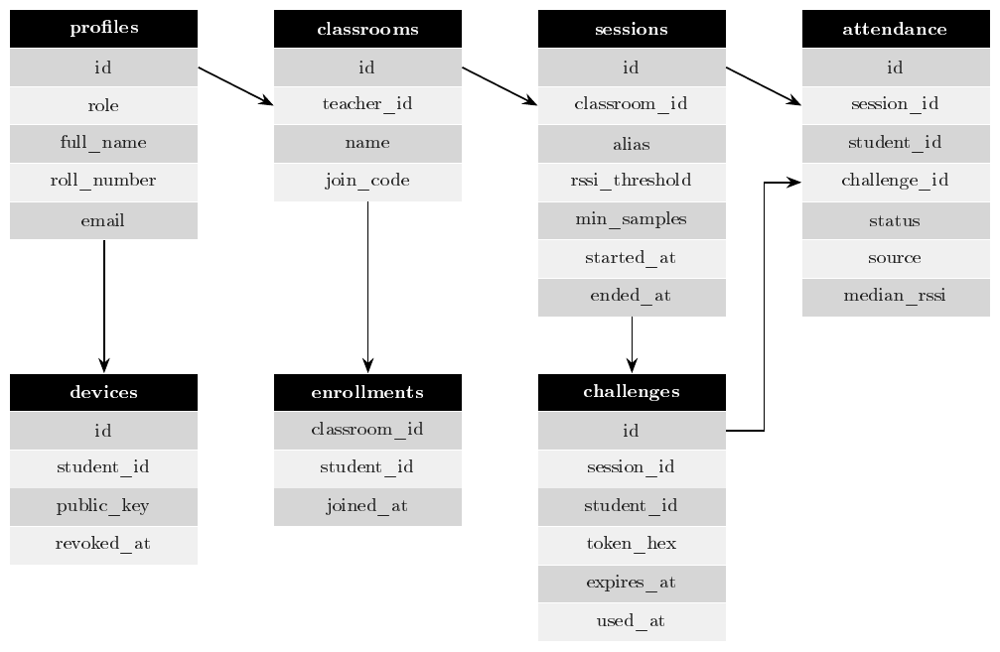
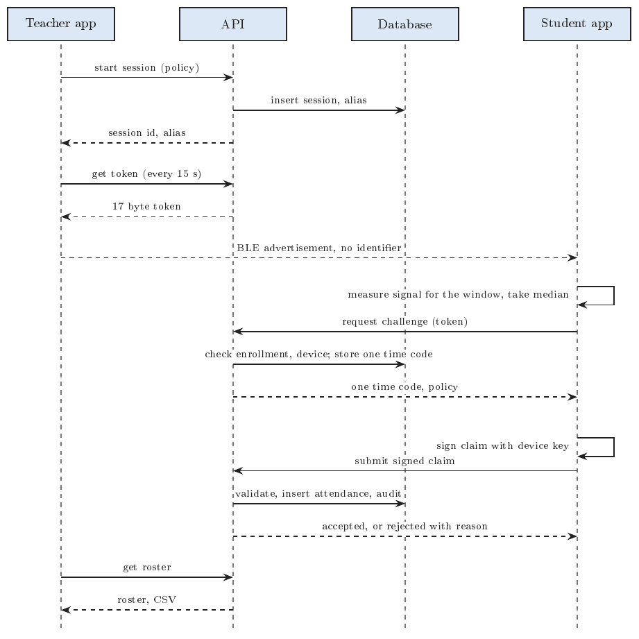

# ClassLink SRS Supplement

This supplement belongs to the [Software Requirements Specification](index.md). It holds reference material that would crowd the main document.

## A. Glossary

| Term | Meaning |
|---|---|
| BLE | Bluetooth Low Energy |
| RSSI | Received signal strength indicator, in dBm. Closer devices read less negative values |
| Epoch | A fixed length time slice used to rotate tokens |
| Alias | Four random bytes that identify a live session in a token |
| Challenge | A single use nonce the server issues after validating a token |
| Claim | A signed statement from a student device that it observed a valid token |
| RLS | Row level security in Postgres |
| JWT | JSON Web Token issued by Supabase Auth |
| SPKI | SubjectPublicKeyInfo, the DER format for public keys |

## B. API Summary

| Method and path | Role | Purpose |
|---|---|---|
| `POST /v1/profile` | any user | Create the caller's profile |
| `GET /v1/me` | any | Read the caller's profile |
| `POST /v1/classrooms` | teacher | Create a classroom |
| `GET /v1/classrooms` | any | List own classrooms |
| `POST /v1/classrooms/join` | student | Join with a join code |
| `PUT /v1/devices/me` | student | Bind a device signing key |
| `POST /v1/sessions` | teacher | Start a session |
| `POST /v1/sessions/{id}/end` | teacher | End a session |
| `GET /v1/sessions/{id}/token` | teacher | Current rotating token |
| `GET /v1/sessions/{id}/roster` | teacher | Live roster |
| `POST /v1/sessions/{id}/corrections` | teacher | Manual correction |
| `GET /v1/sessions/{id}/export.csv` | teacher | CSV export |
| `POST /v1/attendance/challenge` | student | Trade a token for a nonce |
| `POST /v1/attendance/claim` | student | Submit a signed claim |
| `GET /healthz`, `GET /readyz` | none | Liveness and readiness |

## C. Rejection Reasons

The API returns HTTP 409 with `{"status": "rejected", "reason": "<code>"}`.

| Code | Meaning | Stage |
|---|---|---|
| invalid_token | Malformed token or wrong tag | challenge |
| token_expired | Token epoch outside the grace window | challenge |
| session_not_active | Unknown alias or ended session | challenge, claim |
| not_enrolled | Student is not in the classroom | challenge |
| no_device_bound | Student has no active device key | challenge, claim |
| challenge_unknown | Nonce missing or issued to someone else | claim |
| challenge_expired | Nonce older than 120 seconds | claim |
| nonce_reused | Nonce consumed by a different claim | claim |
| token_mismatch | Claim token differs from the challenge token | claim |
| bad_signature | Signature does not verify against the active key | claim |
| claim_stale | Observation time more than 60 seconds from server time | claim |
| too_few_samples | Sample count below the session minimum | claim |
| rssi_below_threshold | Median RSSI weaker than the session threshold | claim |
| duplicate | The student already has a record in this session | claim |

## D. Evaluation Plan and Data Schema

**Primary metric.** Detection success rate: the fraction of labelled position scan attempts (front, middle, back, door, corridor, adjacent room) that accept or reject correctly under the configured policy.

**Secondary metrics.** Discovery latency, attendance completion latency, false accept and false reject rates at out of room and in room positions, API p50 and p95 latency, and the rejection rate for duplicate claims and expired tokens.

**Method.** One teacher phone and at least two student phones of different models, in a real classroom. Record raw rows before computing any summary.

**Raw CSV schema** (`docs/evaluation/*.csv`):

| Column | Meaning |
|---|---|
| run_id | Identifier for one scenario run |
| timestamp_utc | ISO 8601 time of the attempt |
| teacher_phone, student_phone | Device models |
| android_version | Version on the student phone |
| room_label | Room name |
| position_label | front, middle, back, door, corridor, adjacent_room |
| expected | accept or reject |
| median_rssi_dbm, sample_count | Values sent in the claim |
| result | accepted or the rejection reason |
| discovery_ms, completion_ms | Latencies |

## E. Test Traceability

Backend tests live in `backend/tests/` and run against a real Postgres.

| Requirements | Tests |
|---|---|
| FR-ACC-01 to FR-ACC-03, FR-CLS-01, FR-CLS-02, FR-DEV-01, FR-DEV-02 | `test_teacher_and_accounts.py`, `test_attendance_flow.py` |
| FR-SES-01 to FR-SES-04 | `test_tokens.py`, `test_teacher_and_accounts.py` |
| FR-ATT-02 to FR-ATT-07 | `test_attendance_flow.py`, `test_claims.py`, `test_crypto.py` |
| FR-ROS-01, FR-COR-01, FR-EXP-01, FR-AUD-01 | `test_teacher_and_accounts.py`, `test_attendance_flow.py`, `test_rls.py` |
| Row level security, signed claim coverage, atomic writes (Section 4) | `test_rls.py`, `test_attendance_flow.py` |

Requirements marked Planned have no automated test yet. The Flutter unit tests live in `code/test/`.

## F. Data Tables and Sequence Diagram

The tables behind the data stores in the level 1 diagram, and how they link.

## G. How the Server Checks a Claim

The server runs these checks in order. The first failed check ends the flow with a reason code, and every outcome is audited.

